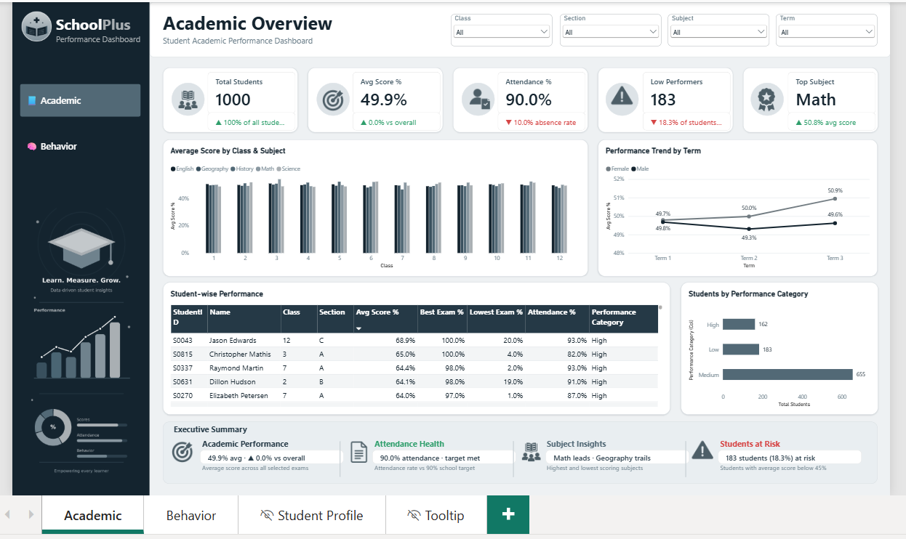
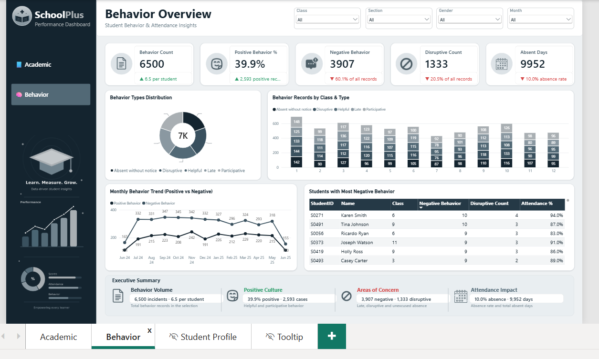

<div align="center">

# 🎓 -- ! SchoolPlus Student Performance Dashboard ! -- 🎓
### *Interactive Power BI Dashboard for Academic, Attendance & Behavioral Insights*

[](https://powerbi.microsoft.com/)
[](https://learn.microsoft.com/en-us/dax/)
[](https://powerbi.microsoft.com/)
[](#-dataset)
[](#)

<br/>

> *"Every student has a story — a good dashboard helps you read it."* 📊

</div>

---

## 📋 Table of Contents

- [📌 Overview](#-overview)
- [🎯 Problem Statement](#-problem-statement)
- [✨ Key Features](#-key-features)
- [🏗️ Project Structure](#️-project-structure)
- [🔄 Project Workflow](#-project-workflow)
- [📂 Dataset](#-dataset)
- [🧬 Data Model](#-data-model)
- [🎨 Design & Theme](#-design--theme)
- [🖼️ Dashboard Screenshots](#️-dashboard-screenshots)
- [🎥 Project Video](#-project-video)
- [🪜 Steps to Build the Dashboard](#-steps-to-build-the-dashboard)
- [✅ Task Requirement Coverage](#-task-requirement-coverage)
- [🛠️ Tools & Technologies](#️-tools--technologies)
- [📈 Results & Insights](#-results--insights)
- [🏆 Advantages](#-advantages)
- [🚀 How to Run](#-how-to-run)
- [📄 License](#-license)
- [👤 Author](#-author)
- [🙏 Acknowledgements](#-acknowledgements)

---

## 📌 Overview

The **SchoolPlus Student Performance Dashboard** is an interactive **Power BI** report that analyzes the **academic performance, attendance and behavior** of **1,000 students** across **12 classes, 3 sections, 5 subjects and 3 terms**. Users can explore the data with slicers, jump between pages using a branded sidebar, and open a full **individual student profile** with a single right-click.

This project was built for the **"Student Performance Dashboard – Academic & Behavioral Insights"** exam task (50 marks) and is designed to:
- 📊 Convert raw school records into clear, visual insights
- 🧹 Practice data cleaning and data modeling using **Power Query**
- 🧮 Create **KPI and analysis measures** using **DAX**
- 🎨 Build a clean, branded and professional dashboard with navigation, drillthrough and tooltips
- 📖 Tell a story with an **Executive Summary** panel on every analysis page

**📑 Dashboard pages:**

| # | Page | Type | Purpose |
|---|------|------|---------|
| 1 | 🎓 **Academic** | Visible | Scores, attendance and performance categories |
| 2 | 🧠 **Behavior** | Visible | Behavior types, trends and attendance impact |
| 3 | 👤 **Student Profile** | Hidden · Drillthrough | Full profile of one selected student |
| 4 | 💬 **Tooltip** | Hidden · Tooltip | Mini-card shown when hovering over charts |

---

## 🎯 Problem Statement

> **Objective:** Analyze student scores, attendance and behavior records to understand how students perform across classes, subjects and terms, and how attendance and behavior relate to the overall picture.

Business questions answered by this dashboard:

| ❓ Question | 📊 Visual Used |
|------------|----------------|
| How many students are there and what is the average score and attendance? | KPI Cards |
| How do classes and subjects compare on average score? | Clustered Column Chart – Average Score by Class & Subject |
| Is performance improving from Term 1 to Term 3? | Line Chart – Performance Trend by Term |
| Which students are performing well or need support? | Table – Student-wise Performance + Performance Category Bar Chart |
| What types of behavior are most common? | Donut Chart – Behavior Types Distribution |
| Which classes have the most behavior records? | Stacked Column Chart – Behavior Records by Class & Type |
| How do positive and negative behavior change over the year? | Line Chart – Monthly Behavior Trend |
| Which students have the most negative behavior? | Table – Students with Most Negative Behavior |
| What does one individual student's profile look like? | Drillthrough Page – Student Profile |

---

## ✨ Key Features

| Feature | Description |
|--------|-------------|
| 🎛️ **Interactive Slicers** | Academic page: **Class, Section, Subject, Term** · Behavior page: **Class, Section, Gender, Month** · Class & Section are synced across pages |
| 💳 **KPI Cards (10)** | 5 KPI cards on each page with icon, title, value and a green ▲ / red ▼ insight line |
| 📊 **Interactive Charts** | Bar/column, line, donut, stacked column and category charts that cross-filter each other |
| 📋 **Student-wise Table** | StudentID, Name, Class, Section, Avg Score %, Best Exam %, Lowest Exam %, Attendance %, Performance Category with conditional formatting (green ≥ 80%, red < 40%) |
| 🏷️ **Performance Category** | High / Medium / Low based on average % score using `SWITCH` |
| 🔍 **Drillthrough** | Right-click a student in either table → **Drill through → Student Profile** |
| 💬 **Report-page Tooltips** | Hover on a chart bar to see a mini card with Avg Score, Attendance % and a Term-wise mini chart |
| 🧭 **Sidebar Navigation** | Branded **SchoolPlus** sidebar with page-navigation buttons and a transparent illustration |
| 📖 **Executive Summary** | 4-column dynamic insight panel at the bottom of the Academic and Behavior pages |
| 🎨 **Custom Theme** | Slate / blue-grey colour palette applied through `theme.json` |
| 📅 **Calendar Table** | Month-level analysis of attendance and behavior |

---

## 🏗️ Project Structure

```
📦 student_performance/
│
├── 📄 student_performance.pbix                 ← Main Power BI report
│
├── 📁 assets/
│   ├── 🖼️ Academic.png                         ← Academic page screenshot
│   └── 🖼️ Behavior.png                         ← Behavior page screenshot
│
├── 📁 dataset/
│   ├── 📄 Students_-_Students.csv              ← Student master data
│   ├── 📄 Scores_-_Scores.csv                  ← Exam scores
│   ├── 📄 Attendance_-_Attendance.csv          ← Daily attendance
│   ├── 📄 Behavior_-_Behavior.csv              ← Behavior records
│   └── 🎨 theme.json                           ← Custom Power BI colour theme
│
└── 📄 README.md                                ← Project documentation
```

---

## 🔄 Project Workflow

```
Raw Datasets (4 CSV files)
      │
      ▼
┌─────────────────────────────┐
│   Import Data in Power BI   │  ← Get Data → Text/CSV
└────────────┬────────────────┘
             │
             ▼
┌─────────────────────────────┐
│   Clean & Transform Data    │  ← Power Query: types, trim, null handling
└────────────┬────────────────┘
             │
             ▼
┌─────────────────────────────┐
│   Build the Data Model      │  ← Star schema + Calendar table
└────────────┬────────────────┘
             │
             ▼
┌─────────────────────────────┐
│   Create DAX Measures       │  ← Scores, Attendance, Behavior, KPIs
└────────────┬────────────────┘
             │
             ▼
┌─────────────────────────────┐
│   Apply Theme & Layout      │  ← theme.json, sidebar, logo, canvas 1920×1080
└────────────┬────────────────┘
             │
             ▼
┌─────────────────────────────┐
│   Build Visuals & Slicers   │  ← KPI Cards, Charts, Tables, Executive Summary
└────────────┬────────────────┘
             │
             ▼
┌─────────────────────────────┐
│   Drillthrough & Tooltips   │  ← Student Profile + Tooltip pages
└────────────┬────────────────┘
             │
             ▼
     Save / Publish / Share ✅
```

---

## 📂 Dataset

| 📌 Detail | 📄 Information |
|-----------|----------------|
| **Name** | Student Performance Dataset |
| **Files** | 4 CSV files in the `dataset/` folder |
| **Total Rows** | 137,500 (1,000 + 30,000 + 100,000 + 6,500) |
| **Students** | 1,000 students · 525 Male · 475 Female |
| **Classes / Sections** | Class 1 – 12 · Sections A, B, C |
| **Subjects** | Math, Science, English, History, Geography |
| **Exam Types** | Unit Test, Mid Term, Final Exam |
| **Terms** | Term 1, Term 2, Term 3 |
| **Period** | 16 Jun 2024 – 16 Jun 2025 (attendance & behavior dates) |
 **Source Link** | 🔗 [**Student Performance**]
 (https://docs.google.com/spreadsheets/d/1FyNgWuBnoiwf7_9Yb5ZStWbj1ELPKwv5Tgtd8t_fXcg/edit?gid=692274714#gid=692274714) |
 (https://docs.google.com/spreadsheets/d/1PteaBhjAYl_v022lU6avnvtcLcwVOJmy1E4IzAYDIMY/edit?gid=1067504972#gid=1067504972) |
 (https://docs.google.com/spreadsheets/d/1M92qGKCxAOdbU-5h-nFgE39dK3tElee9HVLr26fHMUo/edit?gid=93186480#gid=93186480) |
 (https://docs.google.com/spreadsheets/d/1GIRaDXteNH-rTV7RDkeUpMC2vT7f9vfdV1OeCtgCAnk/edit?gid=1009022224#gid=1009022224) |


**📑 Tables in the dataset:**

| 📄 File | Rows | Columns | Description |
|--------|------|---------|-------------|
| **Students** | 1,000 | `StudentID`, `Name`, `Gender`, `Class`, `Section` | One row per student |
| **Scores** | 30,000 | `StudentID`, `Subject`, `ExamType`, `Score`, `MaxScore`, `Term` | Exam marks (MaxScore = 100) |
| **Attendance** | 100,000 | `StudentID`, `Date`, `Status`, `Reason` | Daily Present / Absent record |
| **Behavior** | 6,500 | `StudentID`, `Date`, `BehaviorType`, `Notes` | Behavior incidents with notes |

**🧹 Data quality notes:**

| Check | Finding | Action |
|-------|---------|--------|
| Null values | `Attendance[Reason]` has **90,048 nulls** (these are the *Present* days) | Replaced with `No Reason (Present)` |
| Duplicates | `StudentID` is unique in `Students` | No change needed |
| Data types | `Date` columns loaded as text | Converted to **Date** |
| `Class` column | Numeric 1 – 12 would be summed/sorted incorrectly | Set as **Text** + helper column `Class No` for correct sort order |
| Text columns | Possible extra spaces | **Trim** + proper-case on names |

**🧠 Behavior types:** `Helpful`, `Participative` (positive) · `Late`, `Disruptive`, `Absent without notice` (negative)

---

## 🧬 Data Model

A **star schema** with `Students` at the centre and a `Calendar` table for time analysis. All relationships are **One-to-Many** with **single-direction** filtering.

```
                    ┌──────────────┐
                    │   Calendar   │
                    └──────┬───────┘
                           │ Date (1 → *)
         ┌─────────────────┼──────────────────┐
         ▼                                    ▼
┌──────────────┐                      ┌──────────────┐
│  Attendance  │                      │   Behavior   │
└──────▲───────┘                      └──────▲───────┘
       │ StudentID (* ← 1)                   │ StudentID (* ← 1)
       │            ┌──────────────┐         │
       └────────────┤   Students   ├─────────┘
                    └──────▲───────┘
                           │ StudentID (* ← 1)
                    ┌──────┴───────┐
                    │    Scores    │
                    └──────────────┘
```

| From (One) | To (Many) | Cardinality |
|-----------|-----------|-------------|
| `Students[StudentID]` | `Scores[StudentID]` | 1 : * |
| `Students[StudentID]` | `Attendance[StudentID]` | 1 : * |
| `Students[StudentID]` | `Behavior[StudentID]` | 1 : * |
| `Calendar[Date]` | `Attendance[Date]` | 1 : * |
| `Calendar[Date]` | `Behavior[Date]` | 1 : * |

A separate `_Measures` table stores all DAX measures. `Calendar[MonthYear]` is sorted by `MonthSort`, and `Students[Class]` is sorted by `Class No`.

---

## 🎨 Design & Theme

The dashboard uses a calm **slate / blue-grey** palette (defined in `dataset/theme.json`) with a branded **SchoolPlus** sidebar. Green and red are used only for conditional formatting and ▲ / ▼ insight lines.

| 🎨 Colour | Hex | Used For |
|----------|-----|----------|
| ⬛ Darkest slate | `#14242F` | Sidebar background, titles, KPI values |
| ⬛ Dark slate | `#253946` | Table headers, button hover |
| 🟦 Slate blue | `#39505E` | Chart series |
| 🟦 Mid slate | `#526976` | Chart series, active sidebar button |
| ⬜ Grey slate | `#6F828D` | Secondary text |
| ⬜ Light slate | `#8A98A1` | Chart series, gridlines |
| ⬜ Silver | `#A9AFB3` | Borders, chart series |
| 🟩 Green | `#2E9E6B` | Positive ▲ / values ≥ 80% |
| 🟥 Red | `#D64545` | Negative ▼ / values < 40% |

```json
{
  "name": "Student Dashboard",
  "dataColors": ["#14242F","#39505E","#526976","#8A98A1","#A9AFB3","#6F828D","#253946","#2E9E6B"],
  "background": "#FFFFFF",
  "foreground": "#14242F",
  "tableAccent": "#253946"
}
```

- 🖥️ **Canvas size:** 1920 × 1080
- 🏷️ **Branding:** SchoolPlus logo + name, "Performance Dashboard" tagline and a transparent illustration in the sidebar
- 🧱 **Layout:** Sidebar → Header with slicers → KPI row → Charts → Table / Category chart → Executive Summary

---

## 🖼️ Dashboard Screenshots

### 🎓 1. Academic Page

> Academic Overview with slicers (Class, Section, Subject, Term), 5 KPI cards, score charts, student-wise table and Executive Summary.

<div align="center">



</div>

<br/>

### 🧠 2. Behavior Page

> Behavior Overview with slicers (Class, Section, Gender, Month), 5 KPI cards, behavior distribution, monthly trend, top negative-behavior students and Executive Summary.

<div align="center">



</div>

<br/>

### 👤 3. Hidden Pages (not shown in the tab bar)

| Page | How to open | What it shows |
|------|-------------|---------------|
| **Student Profile** | Right-click a student row in the Academic or Behavior table → **Drill through → Student Profile** | Student name, Avg Score %, Attendance %, Behavior Count, Absent Days, Performance Category, subject-wise scores, term trend, behavior types, behavior records and monthly attendance |
| **Tooltip** | Hover over a bar in *Average Score by Class & Subject* or *Students by Performance Category* | Avg Score %, Attendance % and a Term-wise mini chart for that selection |

---

## 🪜 Steps to Build the Dashboard

### 🔹 Step 1 — Import the Data
- Open **Power BI Desktop** → **Home → Get Data → Text/CSV**
- Load all four files from the `dataset/` folder and click **Transform Data**
- Rename the tables to `Students`, `Scores`, `Attendance`, `Behavior`

### 🔹 Step 2 — Clean & Transform (Power Query)
- Set correct **data types**: `Date` → Date, `Score` / `MaxScore` → Whole Number, `Class` → **Text**
- Replace nulls in `Attendance[Reason]` with `No Reason (Present)`
- **Trim** text columns and capitalise names
- Remove duplicates on `Students[StudentID]`
- Click **Close & Apply**

### 🔹 Step 3 — Build the Data Model
- Create the `Calendar` table and the relationships shown in [Data Model](#-data-model)
- Add the helper column `Class No` and sort `Class` by it
- Hide `StudentID` in the fact tables (`Scores`, `Attendance`, `Behavior`)

```DAX
Calendar =
ADDCOLUMNS(
    CALENDAR(DATE(2024,6,1), DATE(2025,6,30)),
    "Year", YEAR([Date]),
    "MonthNo", MONTH([Date]),
    "Month", FORMAT([Date], "MMM"),
    "MonthYear", FORMAT([Date], "MMM yy"),
    "MonthSort", YEAR([Date]) * 100 + MONTH([Date])
)

Class No = VALUE(Students[Class])
```

### 🔹 Step 4 — Create DAX Measures
**Calculated column (in `Scores`) and core measures:**

```DAX
% Score Row    = DIVIDE(Scores[Score], Scores[MaxScore])

Total Students = DISTINCTCOUNT(Students[StudentID])

% Score        = AVERAGE(Scores[% Score Row])

Avg Score %    = DIVIDE(SUM(Scores[Score]), SUM(Scores[MaxScore]))

Average Score per Subject =
CALCULATE([Avg Score %], ALLEXCEPT(Scores, Scores[Subject]))

Attendance % =
DIVIDE(
    CALCULATE(COUNTROWS(Attendance), Attendance[Status] = "Present"),
    COUNTROWS(Attendance)
)

Behavior Count = COUNTROWS(Behavior)

Performance Category =
VAR s = [Avg Score %]
RETURN
SWITCH(
    TRUE(),
    ISBLANK(s), BLANK(),
    s >= 0.55, "High",
    s >= 0.45, "Medium",
    "Low"
)
```

> 💡 Performance Category thresholds (High ≥ 55%, Medium ≥ 45%, Low < 45%) are set according to the actual score distribution of this dataset, where student averages lie between roughly 34% and 69%.

**Supporting measures:**

```DAX
Low Performers =
COUNTROWS(FILTER(Students, NOT ISBLANK([Avg Score %]) && [Avg Score %] < 0.45))

Top Subject =
VAR t = ADDCOLUMNS(VALUES(Scores[Subject]), "@Avg", [Avg Score %])
RETURN MAXX(TOPN(1, t, [@Avg], DESC), Scores[Subject])

Best Exam %   = MAX(Scores[% Score Row])
Lowest Exam % = MIN(Scores[% Score Row])

Absent Days = CALCULATE(COUNTROWS(Attendance), Attendance[Status] = "Absent")

Positive Behavior =
CALCULATE([Behavior Count], Behavior[BehaviorType] IN {"Helpful", "Participative"})

Negative Behavior =
CALCULATE([Behavior Count],
    Behavior[BehaviorType] IN {"Late", "Disruptive", "Absent without notice"})

Positive Behavior % = DIVIDE([Positive Behavior], [Behavior Count])

Disruptive Count =
CALCULATE([Behavior Count], Behavior[BehaviorType] = "Disruptive")

Selected Student = SELECTEDVALUE(Students[Name], "All Students")
```

**Performance Category as a column** (needed to count / chart students per category):

```DAX
Performance Category (Col) =
VAR s = CALCULATE(DIVIDE(SUM(Scores[Score]), SUM(Scores[MaxScore])))
RETURN SWITCH(TRUE(), s >= 0.55, "High", s >= 0.45, "Medium", "Low")
```

**KPI insight lines (▲ green / ▼ red)** — examples:

```DAX
KPI Sub Score =
VAR d = [Avg Score %] - CALCULATE([Avg Score %], ALL(Students), ALL(Scores))
RETURN IF(d >= 0, "▲ ", "▼ ") & FORMAT(ABS(d), "0.0%") & " vs overall"

KPI Color Score =
IF([Avg Score %] >= CALCULATE([Avg Score %], ALL(Students), ALL(Scores)), "#2E9E6B", "#D64545")

KPI Sub Attendance =
VAR d = [Attendance %] - 0.9
RETURN IF(d >= 0, "▲ ", "▼ ") & FORMAT(ABS(d), "0.0%") & " vs 90% target"

KPI Color Attendance = IF([Attendance %] >= 0.9, "#2E9E6B", "#D64545")
```

**All KPI and Executive Summary measures:**

| Page | Measures |
|------|----------|
| 🎓 Academic · KPI lines | `KPI Sub Students`, `KPI Sub Score`, `KPI Sub Attendance`, `KPI Sub Low`, `KPI Sub Top`, `KPI Color Score`, `KPI Color Attendance` |
| 🧠 Behavior · KPI lines | `KPI Sub Incidents`, `KPI Sub Positive`, `KPI Sub Negative`, `KPI Sub Disruptive`, `KPI Sub Absent` |
| 🎓 Academic · Executive Summary | `ES Academic 1` … `ES Academic 4` |
| 🧠 Behavior · Executive Summary | `ES Behavior 1` … `ES Behavior 4` |

### 🔹 Step 5 — Apply Theme & Canvas
- **View → Themes → Browse for themes** → import `dataset/theme.json`
- Set **Canvas settings → Custom → 1920 × 1080** and the page background to `#EEF1F3`

### 🔹 Step 6 — Build the Sidebar & Navigation
- Add a dark sidebar (`#14242F`) with the **SchoolPlus** logo, name and tagline
- Add page-navigation buttons for **Academic** and **Behavior** (active page highlighted in `#526976`, hover `#253946`)
- Place the transparent illustration below the buttons

### 🔹 Step 7 — Add Slicers
- Dropdown slicers in the header: **Class, Section, Subject, Term** (Academic) and **Class, Section, Gender, Month** (Behavior)
- Use **Sync slicers** for Class and Section across pages

### 🔹 Step 8 — Add KPI Cards
- Each KPI card = rounded white container + icon + title/value (new **Card** visual) + coloured ▲ / ▼ insight line
- **Academic:** Total Students · Avg Score % · Attendance % · Low Performers · Top Subject
- **Behavior:** Behavior Count · Positive Behavior % · Negative Behavior · Disruptive Count · Absent Days

### 🔹 Step 9 — Build the Charts
- 📊 **Average Score by Class & Subject** → Clustered Column Chart (Axis: Class, Legend: Subject)
- 📈 **Performance Trend by Term** → Line Chart (Axis: Term, Legend: Gender)
- 📊 **Students by Performance Category** → Bar Chart
- 🍩 **Behavior Types Distribution** → Donut Chart
- 📊 **Behavior Records by Class & Type** → Stacked Column Chart
- 📈 **Monthly Behavior Trend** → Line Chart (Positive vs Negative)

### 🔹 Step 10 — Tables & Conditional Formatting
- **Student-wise Performance** table (Academic) and **Students with Most Negative Behavior** table (Behavior, sorted by Negative Behavior)
- Apply **Rules-based conditional formatting** on the score columns: **≥ 80% → green** `#2E9E6B`, **< 40% → red** `#D64545`

### 🔹 Step 11 — Add the Executive Summary
- Add a 4-column panel at the bottom of the Academic and Behavior pages
- Each column = icon + coloured heading + dynamic insight line (`ES …` measures) + short description

### 🔹 Step 12 — Create the Student Profile (Drillthrough)
- Add a new page → drag `Students[StudentID]` into the **Drill through** field well → hide the page
- Add KPI cards, subject bar chart, term line chart, behavior donut, behavior records table, attendance-by-month chart and a **Back** button

### 🔹 Step 13 — Create the Tooltip Page
- Add a new page → **Page information → Allow use as tooltip**, size 320 × 240 → hide the page
- Add Avg Score %, Attendance % cards and a Term-wise mini chart
- On the chart: **Format → General → Tooltips → Type: Report page → Page: Tooltip**

### 🔹 Step 14 — Save & Share
- Save as `student_performance.pbix`
- Take screenshots of the Academic and Behavior pages and add them in the `assets/` folder

---

## ✅ Task Requirement Coverage

| 📝 Component | Marks | ✔️ How it is covered |
|-------------|-------|----------------------|
| **Data Modeling & Cleaning** | 10 | 4 tables loaded, star-schema relationships, Calendar table, data types fixed, column names cleaned, nulls in `Reason` replaced |
| **DAX Calculations** | 10 | `% Score`, Average Score per Subject, Attendance %, Behavior Count per Type, Performance Category (`SWITCH`), plus KPI and summary measures |
| **Visualizations & Storytelling** | 15 | Bar, line, donut charts, student table with conditional formatting, KPI cards, Executive Summary panel, consistent theme |
| **Slicers, Filters & Drillthrough** | 10 | Slicers for Class, Section, Subject, Term (+ Gender, Month), drillthrough Student Profile page, report-page tooltips, sidebar page navigation |
| **Optional Features** | 5 | Custom branding (SchoolPlus logo + illustration), theme file, dynamic ▲ / ▼ KPI insight lines |

**Required visuals checklist:**

| Required in task | ✅ Implemented as |
|------------------|-------------------|
| Bar chart: Average scores by Subject and Class | Clustered column chart – *Average Score by Class & Subject* |
| Line chart: Performance trend by Term | *Performance Trend by Term* |
| Donut chart: Behavior types distribution | *Behavior Types Distribution* |
| Table: Student-wise scores with conditional formatting | *Student-wise Performance* (green ≥ 80%, red < 40%) |
| Card visuals: Total Students, Average Attendance, Avg Score | KPI cards on the Academic page |
| Slicers: Class, Section, Subject, Term | Header slicers on the Academic page |
| Drillthrough page for individual student profile | *Student Profile* page |
| Tooltips with mini charts or metrics | *Tooltip* page |
| Navigation between Academic and Behavioral views | Sidebar navigation buttons |

---

## 🛠️ Tools & Technologies

| Tool | Purpose |
|------|---------|
| 🟨 **Power BI Desktop** | Dashboard design & reporting |
| 🧹 **Power Query** | Data cleaning & transformation |
| 🧮 **DAX** | Measures, calculated columns & Calendar table |
| 📄 **CSV** | Source data format |
| 🎨 **JSON Theme** | Custom colour palette |
| 🖼️ **PNG Images** | Logo, sidebar illustration & README previews |
| 🐙 **GitHub** | Project hosting & documentation |

---

## 📈 Results & Insights

Key numbers shown in the dashboard (all students, no slicers applied):

| 💳 KPI | 📊 Value |
|--------|----------|
| 👥 **Total Students** | **1,000** |
| 🎯 **Average Score** | **49.9%** |
| 📅 **Average Attendance** | **90.0%** |
| ⚠️ **Low Performers** (avg score < 45%) | **183** (18.3%) |
| 🏆 **Top Subject** | **Math** (50.8% avg score) |
| 📋 **Behavior Records** | **6,500** (6.5 per student) |
| 😊 **Positive Behavior** | **39.9%** (2,593 records) |
| 🚫 **Negative Behavior** | **3,907** (60.1% of records) |
| 🗓️ **Absent Days** | **9,952** (10.0% absence rate) |

**🔍 Key Insights:**

- 🎓 **Scores are very evenly spread.** The overall average is **49.9%**. Math leads (**50.8%**), Science follows (50.0%), and English (49.8%), History (49.5%) and Geography (49.2%) trail — the gap between the best and weakest subject is only about 1.6 points.
- 📈 **Term 3 is slightly stronger.** Average score moves from 49.7% (Term 1) to 49.6% (Term 2) and 50.3% (Term 3), a small improvement in the last term.
- 🏫 **Class 3 scores highest (50.8%)** while **Class 12 scores lowest (48.9%)** among the 12 classes.
- 🏷️ **Performance categories:** 655 students fall in **Medium**, 183 in **Low** and 162 in **High**, so most students sit near the middle of the distribution.
- 📅 **Attendance is exactly at the 90% target** (90.0%), with 9,952 absent days out of 100,000 recorded school days.
- 🧠 **Negative behavior outweighs positive behavior** — 60.1% of records are negative. **Disruptive** is the single most frequent type (1,333 records, 20.5%), followed by Late (1,302), Helpful (1,299), Participative (1,294) and Absent without notice (1,272).
- 🏫 **Behavior records vary by class:** Class 1 has the most records (692) and Class 7 the fewest (428).
- 👤 **Students needing attention:** the Behavior page lists the students with the most negative behavior records (the highest, **S0271 – Karen Smith**, has 10), and the Student Profile page shows their full picture in one click.
- ⚠️ **Note:** the dataset is synthetic, so score averages cluster close to 50% and differences between subjects, classes and terms are small. The dashboard design and DAX logic work the same way on real school data, where larger differences would stand out more clearly.

---

## 🏆 Advantages

| Advantage | Detail |
|-----------|--------|
| 🎓 **Beginner Friendly** | Covers cleaning, data modeling, DAX, visuals, drillthrough and tooltips in one project |
| 🎛️ **Interactive** | Slicers, cross-filtering, drillthrough and hover tooltips update instantly |
| 🎨 **Clean Design** | Consistent slate theme, branded sidebar and rounded KPI cards |
| 📖 **Story-driven** | Executive Summary panels explain the numbers in plain words |
| 🔄 **Reusable** | Same model works for any school with Students / Scores / Attendance / Behavior tables |
| 🧪 **Extensible** | Easy to add Exam Type analysis, teacher view, mobile layout, etc. |

---

## 🚀 How to Run

1. **Clone** or **download** this repository
   ```bash
   git clone https://github.com/priyashihora/Powerbi-Student_performance-Analysis-Project.git
   ```
2. Install **Power BI Desktop** (free) from the Microsoft website
3. Open `student_performance.pbix`
4. If asked, update the data source path to the `dataset/` folder:
   **Home → Transform data → Data source settings → Change Source** for each CSV
5. Click **Refresh** and explore the dashboard 🎉
6. To try the drillthrough, right-click any student in the table → **Drill through → Student Profile**

> 💡 To reuse the colours in another report: **View → Themes → Browse for themes → `dataset/theme.json`**

---

## 📄 License

This project is licensed under the **MIT License** — see the [LICENSE](LICENSE) file for full details.

```
MIT License — Free to use, modify, and distribute with attribution.
```

---

## 👤 Author

<div align="center">

### Priya Shihora

[](https://github.com/PriyaShihora)
[](https://www.linkedin.com/in/Priya_shihora)

> *"Good dashboards don't just show data — they tell decisions."*

**🎓 Role:** Data Analyst | Power BI Enthusiast \
**📍 Location:** India \
**🛠️ Skills:** Power BI · DAX · Power Query · Data Visualization · Excel

</div>

---

## 🙏 Acknowledgements

- 📚 [Microsoft Power BI Docs](https://learn.microsoft.com/en-us/power-bi/) — Official Power BI documentation
- 🧮 [DAX Guide](https://dax.guide/) — DAX function reference
- 🎨 [Flaticon](https://www.flaticon.com/) — Icons used on the KPI cards
- 🎥 [YouTube Power BI Tutorials](https://www.youtube.com/) — Learning & inspiration
- 💬 [Power BI Community](https://community.powerbi.com/) — Problem-solving support

---

<div align="center">

---

*Made with ❤️ and ☕ — Last updated: 3 November, 2026*

</div>
